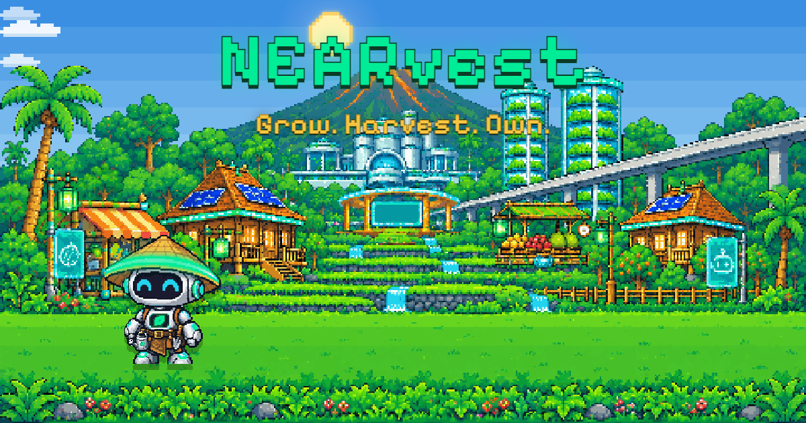

# NEARvest

**Grow. Harvest. Own.**

A pixel farming game where your tree is a living NFT and an AI farmer tends it while you sleep.

- **Play:** https://nearvest-six.vercel.app
- **Try as Judge (no sign-in, ready garden):** https://nearvest-six.vercel.app/play?judge=1
- Demo video: (link added on submission day)
- Network: **NEAR testnet only.** PANEN and the Tree NFTs have no money value.
- Built during the NEAR Hackathon (first commit 2026-11-05) by a solo builder, Ardian Reffa, with **Claude Code**. License: MIT.

**Live numbers** (from the game server's `GET /api/stats`, read on **13 Nov 2026, 05:57 UTC**; they keep changing): 220 Tree NFTs minted, 10,594.25 PANEN minted in total, 1,633 PANEN burned (8,961.25 in circulation), Season 4 (harvest rewards ÷ 8, the lowest level), 49 gardens (judge gardens included), 675 harvests, 419 fruits sold to Mr. Darto. Check them yourself on nearblocks: [Tree NFT](https://testnet.nearblocks.io/nft-token/pohon.nearvest.testnet), [$PANEN](https://testnet.nearblocks.io/token/panen.nearvest.testnet).



---

## 1. Problem and idea

Most web3 games ask a new player to install a wallet, buy gas, approve pop-ups and understand tokens before they can plant a single seed. Most people leave at that step, and the game never gets a chance.

NEARvest does it the other way round: **play first, own later.**

- Sign in with Google. The game creates a NEAR account for you (`<name>.nearvest.testnet`; the game holds its key, see [Honest notes](#8-honest-notes)) and pays the gas.
- No wallet pop-ups while you play. The chain works in the background: your trees are NFTs, your coins are a token, your AI helper has its own account.
- Already have a NEAR wallet? Sign in with it and keep everything in your own account.

The village is **Tandur**, a solarpunk Indonesian village. Core loop: daily check-in → plant a seed (a Tree NFT is born) → water / fertilize (you or TaniBot) → harvest → sell to Mr. Darto (PANEN is minted) → spend in the Shop (the PANEN is burned) → plant again. Old trees drop a superior seed and become Memorial Trees.

---

## 2. Try it in 3 minutes

Best on a laptop with Chrome; phones work too (portrait).

**Try as Judge** opens a ready garden: no sign-in, demo mode (1 game day = 1 minute), real testnet transactions.

| # | Do | See |
|---|---|---|
| 1 | Open https://nearvest-six.vercel.app/play?judge=1 (or **Try as Judge** on the landing page). | A new garden `judge-xxxx.nearvest.testnet` with 3 Tree NFTs (a ripe Rare Durian on plot 1), 100 PANEN, seeds and TaniBot switched on. A gold **Judge tour** chip guides the next steps and links each proof. |
| 2 | Click plot 1 → **Harvest**. | The Rare Durian goes to Storage. The Tree NFT on `pohon.nearvest.testnet` gets its new harvest count (`update_tree`). The tour links the transaction on nearblocks. |
| 3 | Open the **Market** and sell the fruit to **Mr. Darto**. | PANEN is minted to your account with `mint_reward`. The sell button already shows the amount after the Season rule (Season 4 now: ÷ 8). |
| 4 | Open the **Shop** and buy fertilizer or a seed. | The PANEN you spend is **burned** (`burn` on `panen.nearvest.testnet`). Your balance goes down, the village's burned total goes up. |
| 5 | Open **TaniBot** (tour button **Open TaniBot**). TaniBot starts working after your first harvest. | Its **Log**: every action with its reason; on-chain actions link their transaction. Its **budget** and **daily spending limit** (both on chain in the PANEN contract). |
| 6 | Open the **Village** tab. | **Village Stats** read live from the contracts (supply, burned, Season), your on-chain activity with nearblocks links, Memorial Trees with their NFT links. |

**Also try** (the tour lists them too):

| Do | See |
|---|---|
| Tap the **Fishing** pin above the hut on the left → **Cast line**, wait for the bite → **Reel in!** | A fishing pond with TaniBot. The catch is rolled on the server at the cast. Fish pay PANEN (`mint_reward`), junk only gives XP. 5 casts a day. |
| Tap the **Arena** pin ("1 VS 1") → pick a garden → **Duel**. | A Rock / Paper / Scissors "Fruit Fight": you pick, the other garden's TaniBot answers (its pick is locked on the server first). If that player is online they can accept and fight you live. The winner gets 8 PANEN before the Season rule (`mint_reward`). |
| Tap the **Friends** pin → **Farmers of Tandur** → Visit a garden → **Help water**, **Sticker**, **Add friend**. | Their garden with their TaniBot. The owner sees your visit and sticker in their Village tab and can **Wave back**. |

**Sign in normally** at https://nearvest-six.vercel.app/play. New gardens start in **demo mode** (1 game day = 1 minute; you can switch it off on the create screen). A short TaniBot tutorial walks through the loop.

- **Sign in with Google.** The game creates your NEAR account and pays the gas. On iPhone / iPad the page goes to Google in the same tab and comes back.
- **Connect NEAR Wallet** (near-connect, testnet wallets; tested with **Meteor Wallet**). You sign one message (NEP-413), not a transaction.

---

## 3. Tracks

### `games` (main): Games With Real Economies

- **Loop:** check-in calendar (day 7 = Gold seed), 3 plots, plant → water → fertilize → harvest, 3 fruits (Mango fast, Rambutan medium, Durian slow), seed quality Common / Rare / Gold, seed storage of 20, titles from Seedling to Legend.
- **Mr. Darto** (Market NPC) buys fruit and seeds. His prices move every village day (about ±30%, lower after a day of many sales) and stay between the seed price and base + 30% (a server rule). The price you saw is locked: if the day changed, the game asks before selling at the new price.
- **Arena 1 VS 1:** turn-based Fruit Fight against another garden's TaniBot, or **online** against the real player when they are online and accept (10 s per turn for both; the other side's pick is never sent before both picks are in). **Draw rule:** if both fighters are knocked out in the same turn, nobody wins and no prize is minted. Limits: 3 duels a day, 1 per opponent; the same person on two gardens plays for practice (no prize).
- **Fishing:** a pond with day / dusk / night, rain, ducks and frogs. 14 possible catches (5 fish, 5 junk, 4 items). The catch is rolled and stored at the cast and only sent at the reel.
- **Social:** garden visits (help water 1 tree a day for a little XP), 6 template stickers (no free chat), **Wave back**, friends with an Online dot, invite links (**referral**: the inviter gets 20 PANEN before the Season rule and the friend 5 PANEN, paid after the friend's first harvest).
- **Weather and events:** clear, rain (free water), drought (water twice), wilting after 2 days without water (never kills a tree), and the **Mount Tandur eruption** (warning → ash, clean it → Volcanic soil: faster growth, better Gold chance). Demo mode runs one weather cycle in about 10 minutes.
- **Tutorial** guided by TaniBot (plant, water, Shop, fertilize, check-in, harvest, sell, TaniBot, fishing, Arena), skippable; **How to play** pages; Share-to-X cards for big moments.

### `memecoins`: Memecoins With Mechanics

$PANEN (`panen.nearvest.testnet`, NEP-141, 18 decimals).

- **0% team, no pre-mint.** PANEN is only minted as game rewards, and the game server (`game.nearvest.testnet`) is the only minter. Every mint source:
  - with `mint_reward` (Season rule applies): selling fruit and seeds to Mr. Darto, fishing catches, Arena prizes, the inviter's referral reward;
  - with exact `mint` (same in every Season): daily check-in (5 PANEN, 10 on day 7; in demo mode at most 7 paid check-ins per real day), welcome pack (50 PANEN), the invited friend's 5 PANEN, and the starting balance of a Try as Judge garden (topped up to 100 PANEN).
- **Seasons (halving):** `mint_reward` divides by 1, 2, 4, 8 as the total ever minted passes **2,000 / 5,000 / 10,000 PANEN** (testnet thresholds, low on purpose so halving can be seen; the contract's default for a future mainnet is 100,000 / 200,000 / 400,000). Burning never rewinds a Season. Testnet is now in Season 4 (÷ 8, the floor).
- **Burn:** 100% of PANEN spent in the Shop (seeds, fertilizer) is burned on chain. Anyone can only burn their own tokens.
- Supply, burned total and Season are on the Village tab and the landing page, read from `village_stats` / `season_info`.

### `nfts`: NFTs That Do Something

**Living Tree NFT** (`pohon.nearvest.testnet`, NEP-171 / 177 / 178 / 181). Every planted seed mints a Tree NFT into the player's own account.

- **On the NFT:** species, quality, birth time and parent tree (fixed at mint); stage (seed → sprout → tree → fruiting → old), age in game days and harvest count (updated by the game as the tree grows; age and harvests can only go up); the Memorial flag. The NFT's title and description are built from this data.
- **On the game server:** growth speed, watering, weather, fertilizer and the fruit itself. The server grows the tree and writes the stage, age and harvest count to the NFT.
- **Lineage:** an old tree drops one superior seed; the tree planted from it stores the old tree's token id as `parent_id` on chain.
- **Memorial Trees:** an old tree (or one cut down) becomes a Memorial Tree (`make_memorial`): it stays on its plot until the player plants there or moves it, and is listed with its NFT link in the Village tab. The NFT stays in the player's account. TaniBot never harvests an old tree and never plants over a Memorial Tree.
- **NFT images:** 18 pixel-art pictures made from the game's own tree code (one per species and stage, plus Memorial) are in [`web/public/nft`](web/public/nft) (script: [`tools/nft/make-nft-art.mjs`](tools/nft/make-nft-art.mjs)). The contract shows them once its owner points `set_media_base_url` at them; until then the NFTs show a placeholder picture. Quality is in the NFT's title, not in the picture.

### `agents`: Agent Economy

**TaniBot** is the player's AI farmer.

- **Own account:** `bot.<player>.nearvest.testnet` (Google gardens) or `<name>-bot.nearvest.testnet` (wallet gardens). Its only key is a **function call key** for `burn` and `bot_accept` on the PANEN contract, kept encrypted by the server.
- **Budget and limit on chain:** the player sends it a PANEN budget and sets a **daily spending limit** (`set_bot`). The PANEN contract lets a linked bot burn only up to its limit per UTC day and never transfer; only the player can take the budget back (`bot_withdraw`).
- **Who sends what:** Shop purchases from its budget are burns **signed by TaniBot's own account** (relayed by the game, which pays the gas). Harvest, NFT update and sale transactions are sent by the game account `game.nearvest.testnet` (as for the player). Watering is off chain. Every action is in TaniBot's Log with its reason; on-chain actions link their transaction.
- **Brain:** on the hosted demo, TaniBot's **scheduled rounds** (3 a day; demo gardens: the AI at most every 10 minutes) are planned by an LLM on **NEAR AI Cloud** (`Qwen/Qwen3-VL-30B-A3B-Instruct`), and every suggestion is checked by the game rules. Quick reactions between rounds and the fallback (AI off, out of budget, bad answer) are rule-based. Styles: Thrifty / Balanced / Turbo; optional auto-plant (Common seeds only).
- **In the game:** when another player challenges your garden in the Arena and you are not there to accept, your TaniBot fights for it. It grows with your title (6 looks, Seedling to Legend).

---

## 4. Built on NEAR

All on **NEAR testnet**.

| What | Account | Source | Explorer |
|---|---|---|---|
| $PANEN token (NEP-141, NEP-145, NEP-148; Seasons, burn, TaniBot limits) | `panen.nearvest.testnet` | [`contracts/panen`](contracts/panen) | [nearblocks](https://testnet.nearblocks.io/token/panen.nearvest.testnet) |
| Tree NFT (NEP-171, NEP-177, NEP-178, NEP-181) | `pohon.nearvest.testnet` | [`contracts/pohon`](contracts/pohon) | [nearblocks](https://testnet.nearblocks.io/nft-token/pohon.nearvest.testnet) |
| Player account factory (creates `<name>.nearvest.testnet`) | `nearvest.testnet` | [`contracts/factory`](contracts/factory) | [nearblocks](https://testnet.nearblocks.io/address/nearvest.testnet) |
| Game server: minter, relayer (pays gas), only caller of the factory | `game.nearvest.testnet` | [`server`](server) | [nearblocks](https://testnet.nearblocks.io/address/game.nearvest.testnet) |

NEAR features used:

- **NEP-141** fungible token ($PANEN), with NEP-145 storage and NEP-148 metadata.
- **NEP-171 / 177 / 178 / 181** non-fungible token with metadata, approvals and enumeration (Tree NFT), updated as the tree lives.
- **NEP-413** signed messages: NEAR wallet login (one-time nonce, the key must be a full access key of the account), through `@hot-labs/near-connect`.
- **NEP-366** meta transactions: burns are signed by the player's (or TaniBot's) key as a delegate action; `game.nearvest.testnet` relays them and pays the gas. Wallet gardens sign the Shop burn in the browser with a limited game key.
- **Sub-accounts + factory contract:** only `nearvest.testnet` can create `<name>.nearvest.testnet`, so a small factory contract lets the game server create player (and wallet TaniBot) accounts without holding the main account's key. Google TaniBots are sub-accounts of the player (`bot.<player>…`).
- **Function call keys:** TaniBot's only key (`burn`, `bot_accept` on PANEN); wallet gardens add one game key that can only call `burn` on PANEN (0.01 NEAR gas allowance).
- **Contract-enforced spending limit** for an agent (PANEN `set_bot` / `bot_accept` / `bot_info`).
- **NEAR AI Cloud** for TaniBot's planner.

---

## 5. Architecture

```
  Browser (phone / laptop)
  web/ : Vite + Preact + TypeScript, static site on Vercel
        |  HTTPS JSON API (Bearer session token; the web polls, no open connection)
        v
  Game server (VPS, Node.js 24 + TypeScript + node:sqlite + Hono, behind Caddy)
  server/ : Google / NEAR wallet login, game state, village clock (07:00 WIB),
            weather, Mr. Darto, Arena, fishing, social, TaniBot scheduler
            (+ NEAR AI Cloud), chain job queue, relayer
        |  signed transactions (game.nearvest.testnet pays the gas)
        v
  NEAR testnet
  panen.nearvest.testnet (NEP-141)   pohon.nearvest.testnet (NEP-171)
  nearvest.testnet (factory)         player and TaniBot accounts
```

- **Instant game, chain in the background:** an action updates SQLite at once and queues the NEAR transaction. One worker sends the queue in order, retries network errors, and reverts the local balance if a token job fails for good. A toast with the nearblocks link appears when it lands.
- **Server decides:** prices, catches, duel picks and weather are decided and stored on the server; the web only shows them.
- More: [`server/README.md`](server/README.md) (API), [`web/README.md`](web/README.md), [`contracts/README.md`](contracts/README.md).

---

## 6. Run locally

Needs Node.js 24+ (Rust + `cargo-near` only for the contracts). **No real keys are needed:** with `CHAIN_MODE=fake` the chain is simulated in memory and nothing is sent to NEAR.

```sh
# 1) Game server on the fake chain
cd server
npm install
CHAIN_MODE=fake DEV_LOGIN=true WEB_ORIGINS=http://localhost:5173 FISHING=on ARENA_ONLINE=on \
  MASTER_KEY="$(node -e "console.log(require('crypto').randomBytes(32).toString('base64'))")" \
  npm run dev                      # http://127.0.0.1:8787

# 2) Web game (second terminal)
cd web
npm install
npm run dev                        # open http://localhost:5173/play and use "Dev login"
```

- Settings are listed by name only in [`server/.env.example`](server/.env.example) and [`web/.env.example`](web/.env.example): `PORT`, `CHAIN_MODE`, `NEAR_NETWORK`, `NEAR_RPC_URL`, `EXPLORER_TX_URL`, `FACTORY_ACCOUNT_ID`, `PANEN_CONTRACT_ID`, `POHON_CONTRACT_ID`, `GAME_ACCOUNT_ID`, `GAME_PRIVATE_KEY`, `PLAYER_ACCOUNT_DEPOSIT_NEAR`, `MASTER_KEY`, `DATABASE_PATH`, `GOOGLE_CLIENT_ID`, `DEV_LOGIN`, `DEMO_MODE_DEFAULT`, `WEB_ORIGINS`, `TANIBOT_AI`, `NEAR_AI_API_KEY`, `TANIBOT_AI_MODEL`, `TANIBOT_AI_MAX_CALLS_PER_DAY`, `TANIBOT_AI_BUDGET_USD`, `ARENA_ONLINE`, `FISHING`, `FAKE_SEASON`, `TRUST_CF_IP`; web: `VITE_API_URL`. Never commit `.env`.
- Real testnet needs `CHAIN_MODE=near` and your own game account key (`node scripts/init-env.ts` writes a fresh one into `.env` and prints only the public key).
- Tests: `cd server && npm test`, `cd web && npm test`, `cd contracts && cargo test`. Type check: `npm run typecheck` in `server` and `web`.

---

## 7. AI disclosure, assets and libraries

- **Code:** written with **Claude Code** by a solo builder, Ardian Reffa (not a programmer), during the hackathon.
- **AI images (ChatGPT, made at Ardian's request)**, converted to pixel art with the scripts in [`tools/pixelize`](tools/pixelize); originals in [`docs/art-source`](docs/art-source): the village of Tandur (day / dusk / night, laptop and phone), Mr. Darto and his hover cart, TaniBot and its 5 evolutions, the Shop stall with its guard robot, Market and Shop backdrops, the Tandur Arena (day / dusk / night), the fishing pond (laptop and phone, day / dusk / night) and the fishing props, the monorail train, the wind turbine rotor, the village robot and the soil mounds.
- **Drawn in code:** trees, icons, fishing catches, sky, weather, ducks and frogs, effects.
- **Sounds:** CC0 music and sound effects (listed in `docs/ASSETS.md`); some sounds are made in code with Web Audio (pond ambience, fishing, visit sparkle, Gold Durian).
- **Third-party assets:** CC0 art and sounds and OFL fonts (Silkscreen, DotGothic16, Tiny5, self-hosted) are listed with their licenses in [`docs/ASSETS.md`](docs/ASSETS.md).
- **Libraries:** web: Preact, Vite, `@hot-labs/near-connect`, `near-api-js`. Server: Hono, `jose` (Google token check), `near-api-js`, Node's built-in `node:sqlite`. Contracts: `near-sdk` and `near-contract-standards` (Rust).

---

## 8. Honest notes

- **Custodial testnet design for Google gardens:** the server creates the player's NEAR account and holds its key, **encrypted with AES-256-GCM** (the encryption key comes from a server environment variable; never in the repo, never in plain text in the database). The game server can sign for these accounts. Wallet gardens keep their own keys.
- **Small fees paid by wallet players:** wallet gardens pay a tiny testnet fee from their own wallet for the one-time **Shop setup** (adding the limited game key) and for **TaniBot wallet steps** (set limit, add budget, take back). The game pays everything else.
- **No money value:** everything is on testnet. PANEN and the Tree NFTs are testnet assets with no money value.
- **Trust in the contract owner:** the owner account `nearvest.testnet` can add minters, change the Season thresholds and upgrade the contracts. "0% team, no pre-mint" therefore relies on trusting the owner. A mainnet version would have to remove or lock these powers.
- **Light limits:** per-IP and per-browser (device id) limits on free rewards (welcome packs, judge gardens, referrals, duel prizes, fishing) are light guards for a testnet game. The device id comes from the browser and can be changed; the IP limits are the firmer ones.
- **Not used:** NEAR Intents and Chain Signatures (there is no Intents testnet, and the game is testnet only).
- **Server-side state:** only the core assets are on chain ($PANEN, Tree NFTs, player and TaniBot accounts, TaniBot limits). Fruit, seeds, XP, weather, visits, duels and fishing live in the game server's database.
- **AI:** images by ChatGPT and code by Claude Code (see section 7); TaniBot's scheduled rounds use an LLM on NEAR AI Cloud.

---

## 9. Planned after the hackathon (not built yet)

- Farmer Card (soulbound token).
- P2P market between players, with TaniBot trading.
- Village Granary and the weekly Harvest Festival.
- Extra plots (4-9) and tool upgrades.
- Trading in fishing junk for something useful.
- Sending PANEN from the game to another NEAR testnet wallet of yours.
- A TaniBot duel on the sign-in page.
- A pause option for gardens.
- Mainnet is only an idea, nothing is promised: legal advice comes first, and $PANEN would stay 0% team.

---

## 10. License

MIT, see [LICENSE](LICENSE).
